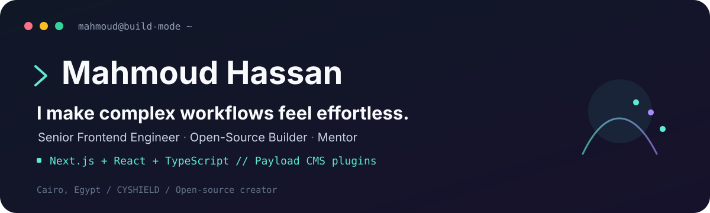

## 👋 About Me

I’m a Cairo-based **Senior Frontend Engineer** at **CYSHIELD**, where I build and modernize web products, support other engineers, and create open-source tools that make Payload CMS more capable for developers and admins.

> `Current focus:` Product engineering · frontend architecture · mentoring engineers

## 💼 Career Highlights

- **CYSHIELD:** Migrated a core dashboard to Next.js, cutting load times by **30%**; mentored **4** junior engineers and helped reduce review revisions by **40%**.
- **Cegedim:** Promoted from **Software Engineer II** to **Senior Software Engineer** in **September 2023**. Built a shared component library adopted by **4 teams**, increasing UI development velocity by **60%**; improved Lighthouse performance from **75 to 92**.
- **HululTech:** Helped build a customer portal serving **10K+ monthly active users** and reduced support volume by **20%**.

## 🧠 Engineering Strengths

| Focus | What I build |
| --- | --- |
| **CMS extensibility** | Reusable Payload plugins that add practical capabilities to real projects. |
| **Identity & access** | Social authentication, session management, and role-based permissions. |
| **Admin workflows** | Flexible navigation, notifications, and audit trails for teams using Payload. |
| **Real-time experiences** | Server-Sent Events from Payload endpoints and hooks to React Native clients. |

## 📦 Payload CMS Open Source

Live npm download counts, refreshed automatically (rolling 18-month window).

[Browse all my npm packages](https://www.npmjs.com/settings/mhmodhsn/packages).

| Plugin | Downloads | What it does |
| --- | --- | --- |
| [**payload-plugin-dictionary**](https://github.com/Mhmod-Hsn/payload-plugin-dictionary) |  | Migrates static front-end translation keys (en.json, ar.json, ...etc) into your database with easy editable/cache. |
| [**react-submit-flow**](https://github.com/Mhmod-Hsn/react-submit-flow) |  | Typed async action flows with accessible, customizable React feedback. |
| [**Payload Audit Logs**](https://github.com/Mhmod-Hsn/payload-audit-logs) |  | Configurable CRUD audit trails with change history and user attribution. |
| [**Payload Advanced Sidebar**](https://github.com/Mhmod-Hsn/Payload-Advanced-Sidebar) |  | Custom navigation groups, icons, and links for the Payload admin. |
| [**Payload Notifications**](https://github.com/Mhmod-Hsn/payload-plugin-notifications) |  | A durable, recipient-scoped notifications inbox for Payload CMS 3. |
| [**Payload RBAC**](https://github.com/Mhmod-Hsn/payload-rbac-plugin) |  | Role-based access control for Payload CMS. |
| [**Payload Social Auth**](https://github.com/Mhmod-Hsn/payload-social-auth) |  | Social authentication for Payload CMS. |

## 🛠️ Technology Stack

<strong>Languages & styling</strong>

  

<strong>Frontend</strong>

  

  
  
  
  
  

<strong>Backend, CMS & data</strong>

  

  
  
  
  

<strong>Testing</strong>

  

  
  

<strong>Developer tools</strong>

  

  

<strong>Design & creative tools</strong>

  
  
  

## 🤝 Connect

- 🌐 [mhmodhsn.tech](https://mhmodhsn.tech)
- 💼 [LinkedIn](https://www.linkedin.com/in/mhmod-hsn)
- 🧑‍💻 [All repositories](https://github.com/Mhmod-Hsn?tab=repositories)

  
📊 GitHub Stats

   
  

